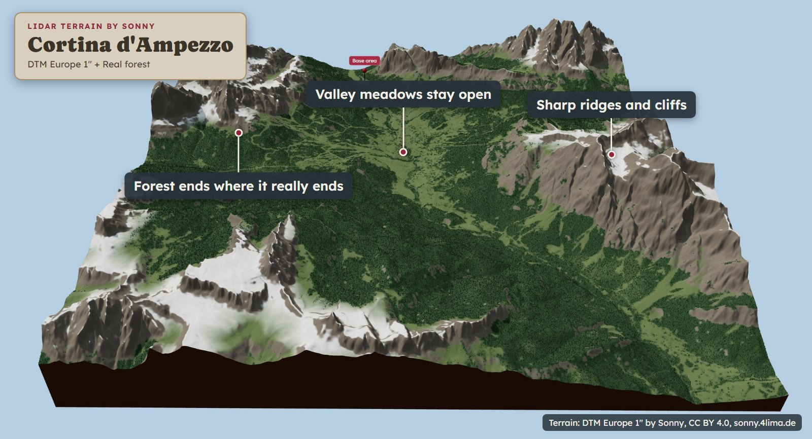
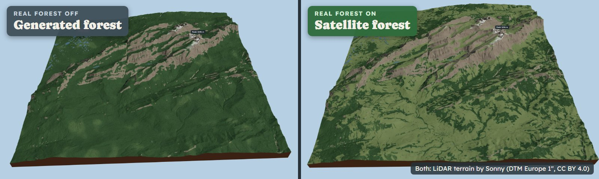
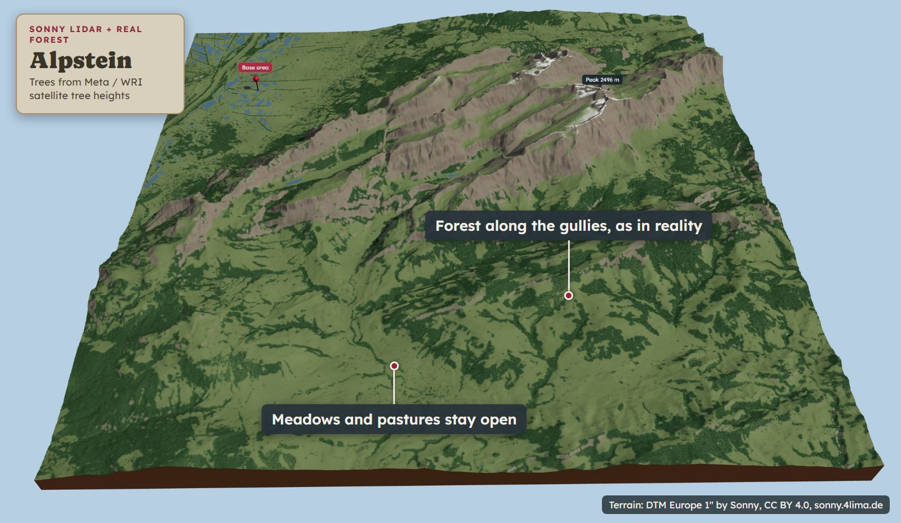

<div align="center">

# Ski-E-O Map Creator

**Turn any real mountain into a playable map for Ski-E-O!**<br>
Real terrain, a forest that fits the region, and the ski area's real trails and lifts, built and installed in a
couple of minutes.

[](https://github.com/haegar123/Skieo-Map-Creator/releases/latest)
[](https://github.com/haegar123/Skieo-Map-Creator/releases)
[](#download-and-play)
[](LICENSE)
[](https://sonny.4lima.de)

[](https://github.com/haegar123/Skieo-Map-Creator/releases/latest)
[](https://nc.yanikruf.ch/s/TFegSqEWEZ2nkoC)
[](docs/Guide-Sonny-Forest.pdf)



<sub>Cortina d'Ampezzo from Sonny's LiDAR terrain, with Real forest, in the Map Creator's 3D view.</sub>

</div>

Fan-made; not affiliated with or endorsed by the developers of Ski-E-O!.

> [!TIP]
> ### Before you start: get the tiles and read the guide
> 1. **[Download the LiDAR tiles](https://nc.yanikruf.ch/s/TFegSqEWEZ2nkoC)** (Sonny's DTM Europe 1") and put them in
>    one folder. No need to unzip them.
> 2. **[Read the Sonny and forest guide (PDF)](docs/Guide-Sonny-Forest.pdf)**: two pages with pictures, showing where
>    to pick the folder and how to switch on Real forest.
>
> Without the tiles the Map Creator still works, but European maps are built from the coarser 30 m data.

## New in this fork

This is a fork of [oofbyte/Skieo-Map-Creator](https://github.com/oofbyte/Skieo-Map-Creator) by oofbyte, who wrote
the Map Creator. It adds:

- **LiDAR terrain for Europe.** Build European mountains from Sonny's LiDAR terrain models instead of the 30 m data:
  sharper ridges, and the real ground instead of the treetops.
  **[Download the tiles](https://nc.yanikruf.ch/s/TFegSqEWEZ2nkoC)** into one folder and pick it with
  **Use LiDAR elevation tiles...** in step 1, right above Load Terrain. The zips can stay as they are, and wherever a
  tile is missing the map is filled from the 30 m data.
- **Real forest.** A new option under Max trees: trees only where satellite images show forest (Meta / WRI tree
  heights), over the whole map. Meadows and clearings stay open, and the forest ends at its real edge.
- **The forest in the 3D view.** The 3D preview shows the trees the map will have, with the settings of the create
  dialog: treeline, tree slope, valley floor, the real trails and lifts cut out, Real forest.



<p align="center"><sub>The Alpstein from Sonny's LiDAR terrain: the generated forest covers almost everything, Real
forest only where the satellite images show trees.</sub></p>

Step by step with pictures: **[Sonny and forest guide (PDF)](docs/Guide-Sonny-Forest.pdf)**. Updates come from
this fork's releases.

> [!IMPORTANT]
> **The European terrain is Sonny's work.** [DTM Europe 1"](https://sonny.4lima.de) is a terrain model of Europe
> that Sonny built, mainly from the national LiDAR surveys, and shares for free under
> [CC BY 4.0](https://creativecommons.org/licenses/by/4.0/). Without it this fork's best feature would not exist.
> The Map Creator only reads the tiles from your PC; they are not included or downloaded by it
> ([download the tiles](https://nc.yanikruf.ch/s/TFegSqEWEZ2nkoC)). **Thank you, Sonny!**
> If you share a map built from these tiles, credit Sonny with it.

## What it does

- **Any mountain on Earth.** Search a ski area, mountain or town, drag the square over it (3 to 20 km wide) and load
  the real elevation: USGS 10 m data in the US, about 30 m everywhere else, or
  [Sonny's LiDAR terrain](https://sonny.4lima.de) in Europe ([above](#new-in-this-fork)).
- **Real trails and lifts.** Switch on **Real trails and lifts** and the ski area's runs and lifts from
  OpenStreetMap are built into the map, ready when you start a New Game, each run as wide as its real cut through
  the forest. Near the runs the forest follows the real tree cover, so open bowls stay open and glades stay wooded.
- **A forest that fits.** The tree species of the game's own maps of the region, mixed and grouped in stands the way
  they are there, with conifers near the summits, up to the treeline, and a tree limit for slower PCs. A map keeps
  at most 1.5 million trees and canopies, about what the game's own biggest maps have, so it runs as smoothly: a
  bigger forest keeps its trees round the lifts and trails, where you play, and grows them a size larger so it
  still looks full. **Experimental mode** allows more, up to the game's full density, at a cost in frame rate (the
  game shows those trees with the **Oof's Tree Limit** mod turned on in Z's Mod Manager).
- **Snow like the game's own maps.** Piles, banks and drifts build up through the winter.
- **3D preview.** Look the terrain and its forest over in 3D before you build it.
- **Installs itself.** The map shows up on the game's world map in its real region, with its real elevations and
  climate. **My Maps** reinstalls, removes or rebuilds your maps with the latest fixes.
- **Updates itself** from this page's releases.

## Screenshots

<table>
<tr>
<td width="50%"></td>
<td width="50%"></td>
</tr>
<tr>
<td align="center"><sub>Whistler Blackcomb in the game</sub></td>
<td align="center"><sub>Stratton, Vermont: every run cut into the forest</sub></td>
</tr>
<tr>
<td width="50%"></td>
<td width="50%"></td>
</tr>
<tr>
<td align="center"><sub>Whistler Blackcomb in the Ski Map: 518 trails, 31 lifts</sub></td>
<td align="center"><sub>Stratton in the Ski Map: 95 trails, 13 lifts</sub></td>
</tr>
</table>



<p align="center"><sub>The Alpstein from Sonny's LiDAR terrain with Real forest: the meadows stay open and the forest follows the gullies, as it
does there</sub></p>

## Download and play

1. Download **SkiEO-Map-Creator.exe** from
   [Releases](https://github.com/haegar123/Skieo-Map-Creator/releases/latest). It's one file, no install. Windows may
   warn because the exe isn't code-signed: click **More info**, then **Run anyway**.
2. For Europe: **[download the LiDAR tiles](https://nc.yanikruf.ch/s/TFegSqEWEZ2nkoC)** into one folder and follow
   the **[guide (PDF)](docs/Guide-Sonny-Forest.pdf)** to pick it with **Use LiDAR elevation tiles...**.
3. Search a mountain or ski area, drag the square over it and press **Load Terrain**.
4. Look over the preview, name your resort, and switch on **Real trails and lifts** for a real ski area.
5. Press **Create Map**. It takes a minute or two; if the game is open, the map is installed as soon as you close it.
6. Start Ski-E-O!, choose **New Game** and pick your map in its region on the world map.

Needs Windows 10 or 11, Ski-E-O! installed through Steam, and an internet connection. No game files are included:
the Map Creator reads what it needs from your own copy of the game. What changed in each version:
[CHANGELOG.md](CHANGELOG.md).

## Mods

Mods for Ski-E-O, the cheat menu, Anarchy, Speed Control, the Doppelmayr R2 lifts and Alpine Buildings among them, are
installed with [Z's Mod Loader](https://mods.bigz.studio), not the Map Creator. Its installer won't install over the
UE4SS the Map Creator's old Mod Library (versions 1.2 to 1.8) put into the game, so the first time it finds the game
closed, version 1.9 takes out what that library installed: its UE4SS (unless other mods use it), its mods, its lift and
building packs and its merged build menu. Your maps stay.

## If something goes wrong

- **The window stays empty.** The window is drawn by Microsoft Edge WebView2. When it can't start, the Map Creator
  tries once more with a fresh browser profile and graphics acceleration off, then says what went wrong. Usually
  WebView2 is damaged (tools that remove Microsoft Edge often leave it half removed): repair it in Windows Settings >
  Apps > Microsoft Edge WebView2 Runtime > Modify, or install it from
  [Microsoft](https://go.microsoft.com/fwlink/p/?LinkId=2124703).
- **The game closes the first time it starts after installing a map.** That can happen once: start it
  again.
- **A big map runs slowly.** The game draws every tree, with its shadow and its sway in the wind, on every frame,
  however far away, so its frame rate goes with the number of trees: Sun Peaks at 14 km with 3.6 million ran at half
  the frame rate of a normal map. Maps built since 1.8.2 keep at most 1.5 million trees and canopies, about what the
  game's own biggest maps have (Whistler: 1.42 million): if yours shows **Rebuild recommended**, rebuild it. Maps
  made in **Experimental mode** with more trees than that run slower by design.
- **A big map has no trees.** The game drops every tree of a map with more than 1.5 million (made in Experimental
  mode, or built before 1.8.2). Turn on **Oof's Tree Limit** in Z's Mod Manager: it raises that limit while the game
  runs, without changing any game file, so game updates don't undo it. My Maps marks those maps **Needs Oof's Tree
  Limit** until it is on. A map built before 1.8.2 can be rebuilt instead, which keeps it under the limit; maps built
  since 1.8.2 outside Experimental mode stay under it and need nothing. (Up to 1.9 the Map Creator raised
  the limit inside the game's exe, which stops the native helpers of Z's Mod Loader; 1.10 puts the game's own value
  back.)
- **Anything else:** press **Copy diagnostics** at the bottom of the Map Creator and paste it into an
  [issue](https://github.com/haegar123/Skieo-Map-Creator/issues). The log is
  `%LOCALAPPDATA%\SkiEO Map Creator\logs\creator.log`.

## Updates

When it starts, the Map Creator looks for a newer release here and asks before updating. The new exe is downloaded
from this page's releases, checked against the release's `SHA256SUMS.txt`, put in place of the old one and started.
Keep the exe in a folder of your own (Desktop, Documents, Downloads) so it can replace itself. **Check for updates**
at the bottom right looks again at any time. Set the environment variable `SKIEO_NO_UPDATE=1` to skip the check at
start.

## Verify a download

Every release exe is built by GitHub Actions from the tagged source (`.github/workflows/release.yml`); nothing is
built or uploaded by hand. Three ways to check one:

1. **SHA-256**: compare with the hash on the release page and in its `SHA256SUMS.txt`:
   `certutil -hashfile SkiEO-Map-Creator.exe SHA256`
2. **Build attestation** (signed proof of which workflow run and commit built it), with the
   [GitHub CLI](https://cli.github.com): `gh attestation verify SkiEO-Map-Creator.exe --repo haegar123/Skieo-Map-Creator`
3. **Compare with the source yourself**: check out the release tag, then
   ```
   py -3.12 -m pip install -r requirements.txt
   py -3.12 packaging\verify_exe.py SkiEO-Map-Creator.exe
   ```
   It opens the exe and checks every bundled file byte for byte and every app module as compiled code against the
   source, and lists everything else inside (Python and the libraries in `requirements.txt`).

## Privacy

What the app connects to: GitHub at each start (this repository's latest release, for updates), map tiles
(OpenStreetMap, OpenTopoMap, Esri World Imagery), place search (Photon, Nominatim), elevation data (USGS 3DEP, AWS
Terrain Tiles) and, with **Real trails and lifts** on, the OpenStreetMap ski data (Overpass API) and tree canopy
heights (Meta / WRI, AWS Open Data). Local elevation tiles are only read from the folder you pick. retoc downloads the
Oodle compression library on first use. No accounts, no telemetry. It writes to `%LOCALAPPDATA%\SkiEO Map Creator`
and the game's `Content\Paks\~mods` folder (and, once, takes out what its old Mod Library put into the game,
[above](#mods)); never to your saves.

## For developers

How the maps are built, running from source, building the exe, the code layout, the tests and releasing:
[docs/DEVELOPMENT.md](docs/DEVELOPMENT.md).

## License

MIT, see [LICENSE](LICENSE). Bundled third-party software keeps its own license; credits for the libraries, fonts and
data sources are in `packaging/THIRD-PARTY.txt`.
